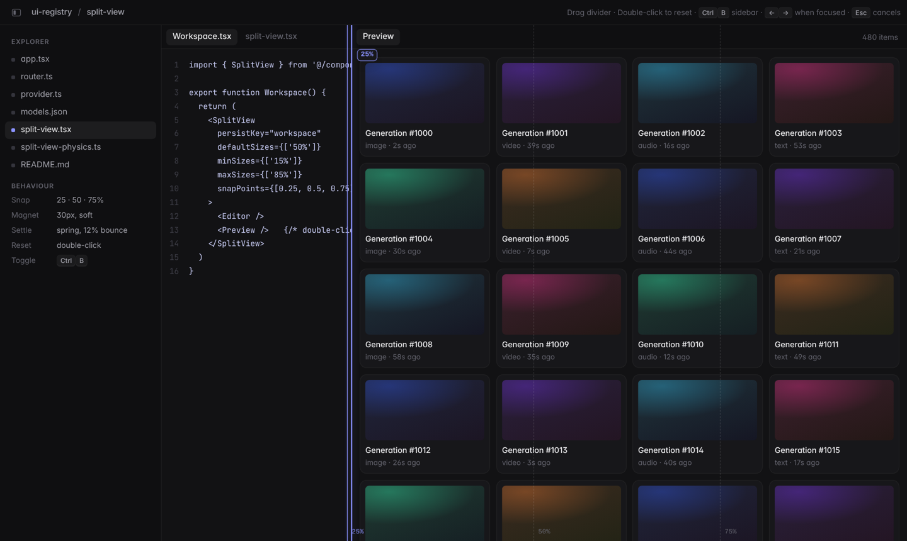

# ui-registry

个人的 shadcn 组件仓库。第一个组件是 **`<SplitView>`**：手感很顺的拖拽分栏。



## SplitView

- **磁吸吸附点**：拖到 25% / 50% / 75% 附近会被轻轻吸住，在吸附范围内松手就落到吸附点，范围外松手就停在原地
- **弹簧回弹**：松手、双击、键盘调整、折叠展开，全都用带速度的弹簧动画，不是死板的补间
- **双击分隔线**：恢复默认尺寸
- **可折叠**：拖过阈值时弹簧收起或展开；收起后边缘有小把手，点一下就能打开
- **记住尺寸**：传 `persistKey`，尺寸和折叠状态会保存在 localStorage
- **横向 / 纵向**，支持 2 或 3 栏（3 栏时中间那栏自适应），更多栏可以嵌套
- 拖动时 React 不会重新渲染，480 张卡片的页面也能跑到约 60fps
- 只用 shadcn 的语义色（`border`、`primary`、`popover`、`foreground`、`muted-foreground`），自动跟随你的主题

### 安装

```bash
npx shadcn@latest add https://raw.githubusercontent.com/next1foreal-dotcom/ui-registry/main/public/r/split-view.json
```

或者用 GitHub 地址（新版 shadcn CLI 支持）：

```bash
npx shadcn@latest add next1foreal-dotcom/ui-registry/split-view
```

会写入 `components/ui/split-view.tsx` 和 `components/ui/split-view-physics.ts`，并安装 `motion` 和 `motion-panels@~0.6.1`。前提是项目已经用 `npx shadcn@latest init` 初始化过（Tailwind v4）。

### 最小用法

```tsx
import { SplitView } from "@/components/ui/split-view"

export function Workspace() {
  return (
    <SplitView className="h-svh" persistKey="workspace">
      <Editor />
      <Preview />
    </SplitView>
  )
}
```

带可折叠侧边栏，再嵌套一个有吸附点的分栏：

```tsx
import { useRef } from "react"
import { SplitView, type SplitViewApi } from "@/components/ui/split-view"

export function App() {
  const sidebar = useRef<SplitViewApi>(null)
  return (
    <>
      <button onClick={() => sidebar.current?.toggle(0)}>切换侧边栏</button>
      <SplitView
        apiRef={sidebar}
        className="h-svh"
        persistKey="sidebar"
        defaultSizes={[256]}
        minSizes={[200]}
        maxSizes={[400]}
        collapsible
        snapPoints={[]}
      >
        <Sidebar />
        <SplitView
          persistKey="editor"
          defaultSizes={["50%"]}
          minSizes={["15%"]}
          maxSizes={["85%"]}
          snapPoints={[0.25, 0.5, 0.75]}
        >
          <Editor />
          <Preview />
        </SplitView>
      </SplitView>
    </>
  )
}
```

三栏（左右都可调，中间自适应，右侧可折叠）：

```tsx
<SplitView
  defaultSizes={["20%", undefined, "20%"]}
  minSizes={["10%", undefined, "10%"]}
  collapsible={[false, false, true]}
>
  <Left />
  <Center />
  <Right />
</SplitView>
```

### Props

尺寸类数组都按**子元素下标**对应，自适应那栏（`fill`）的位置会被忽略。尺寸可以是像素数字（`256`）或百分比字符串（`"30%"`），回调里返回的也是同一种形式。

| Prop | 类型 | 默认值 | 说明 |
| --- | --- | --- | --- |
| `children` | `ReactNode` | — | 2 或 3 个子元素，每个就是一栏 |
| `orientation` | `"horizontal" \| "vertical"` | `"horizontal"` | 横向或纵向分栏 |
| `fill` | `number` | `1` | 哪一栏自适应剩余空间 |
| `defaultSizes` | `(Size \| undefined)[]` | `["50%"]`，三栏时 `"25%"` | 默认尺寸，双击分隔线会回到这里 |
| `minSizes` / `maxSizes` | `(Size \| undefined)[]` | — | 最小 / 最大尺寸 |
| `snapPoints` | `number[]` | `[0.25, 0.5, 0.75]` | 分隔线吸附位置（占整体的比例），传 `[]` 关闭 |
| `magnetRange` | `number` | `30` | 吸附范围，单位 px（单侧） |
| `magnetStrength` | `number` | `0.78` | 吸力，0 表示没有吸力，1 表示非常黏 |
| `spring` | `SplitViewSpring` | `{ visualDuration: 0.32, bounce: 0.12 }` | 松手、双击、键盘后的回弹弹簧，也可以传 `stiffness` / `damping` / `mass` |
| `collapseSpring` | `SplitViewSpring` | `{ visualDuration: 0.36, bounce: 0.06 }` | 折叠和展开用的弹簧 |
| `collapsible` | `boolean \| boolean[]` | `false` | 能否折叠，`true` 表示所有固定尺寸的栏 |
| `collapseThreshold` | `number` | `0.5` | 拖到 `minSize × 阈值` 以下就折叠 |
| `collapsed` / `defaultCollapsed` | `boolean[]` | — | 受控 / 非受控的折叠状态 |
| `onCollapsedChange` | `(collapsed: boolean[]) => void` | — | 折叠状态变化时调用 |
| `overshoot` | `number \| boolean` | `12` | 超出最小或最大尺寸时的橡皮筋距离（px） |
| `persistKey` | `string` | — | 存到 localStorage 的 `split-view:<key>` |
| `onResize` | `(sizes: (Size \| null)[]) => void` | — | 尺寸确定后调用（不是每一帧都调用），自适应栏为 `null` |
| `showGuides` / `showBadge` | `boolean` | 有吸附点时为 `true` | 拖动时显示虚线参考线和百分比标签 |
| `handleLabels` | `(string \| undefined)[]` | `"Resize panel"` | 每个分隔线的 `aria-label` |
| `panelClassNames` | `(string \| undefined)[]` | — | 每一栏的 className |
| `handleClassName` | `string` | — | 分隔线的 className |
| `apiRef` | `Ref<SplitViewApi>` | — | 命令式接口：`collapse(i)`、`expand(i)`、`toggle(i)`、`reset()`、`getSizes()`、`getCollapsed()` |
| `className` 及其他 div 属性 | — | — | 加在最外层容器上 |

键盘：聚焦分隔线后，用 `←` `→`（纵向是 `↑` `↓`）调整，按住 `Shift` 步子更大，`Home` / `End` 到最小 / 最大，`Enter` 折叠或展开，`Esc` 取消拖动。

### 关于 motion-panels 的版本锁定

底层用的是 [motion-panels](https://github.com/letstri/motion-panels)（MIT）。它负责尺寸计算、约束、键盘、无障碍和折叠状态，弹簧和磁吸是 `split-view-physics.ts` 加上去的。

物理层要拿到每条分隔线对应的 panel controller，用的是 motion-panels 导出但**没有写进文档**的 `grips` 注册表，还包装了 controller 的 `drag.start/move/end`，并依赖 `c.target`、`c.state.end` 这些内部字段。所以 registry 里把版本锁成 `motion-panels@~0.6.1`（只接受 0.6.x 的补丁版本）。升级到 0.7 之前，要先跑一下 demo，确认吸附、回弹、折叠都还正常。

### 注意事项

- 用到 `localStorage` 和 DOM，文件开头有 `"use client"`。在 Next.js 里如果用了 `persistKey`，首屏服务端渲染出来的是默认尺寸，跟客户端恢复的尺寸可能不一样，必要时放进只在客户端渲染的组件里
- 一个分组最多 3 栏（motion-panels 的限制：开始端、自适应、结束端各一个），更多栏请嵌套
- 拖动时会给 `<html>` 加上 `split-view-resizing` 类，统一光标并禁止选中文字。全局样式只会注入一次（`<style id="split-view-styles">`）
- 暂未针对 RTL 布局测试

## 本仓库开发

```bash
npm install
npm run dev              # demo，默认端口 8765（PORT=xxxx 可改）
npm run build            # 类型检查 + 构建 demo
npm run registry:build   # 由 registry.json 生成 public/r/*.json
npm run capture          # 无头浏览器截图和手感测试（需要先 npm run dev）
```

目录：

```
registry.json                         # shadcn 源 registry
registry/split-view/split-view.tsx    # 组件
registry/split-view/split-view-physics.ts
public/r/split-view.json              # 构建产物，安装地址指向这里
src/                                  # demo（直接引用 registry/ 里的源码）
```

新增组件：在 `registry/<名字>/` 下写源码，在 `registry.json` 的 `items` 里加一项，然后跑 `npm run registry:build`。

## License

MIT
